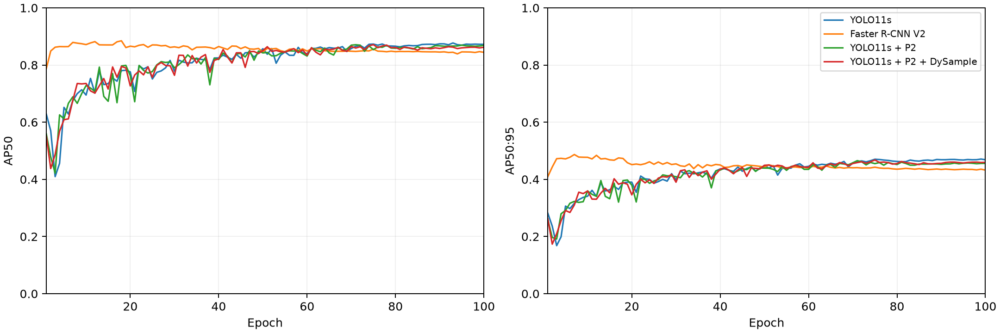

# 实验结果 / Experiment results

本报告来自真实 Beach Bird 官方划分、seed 42 的固定配置实验。每个深度配置完成 100 轮训练；没有超参数搜索或提前停止。

**硬件限制：** 本次使用 RTX 3090 24 GB，并非协议指定的 Colab T4。以下精度为本机结果，不能标成 T4 实验。

RF 的训练和预测继承自原仓库，本次使用同一参考评估器重新计算指标，未重训 RF；原仓库未包含 RF 模型权重。

## 测试集指标

采用 pycocotools 2.0.11、maxDets=[1,10,300]；AP 预过滤 0.001。Precision/Recall/F1 使用置信度 0.25 和 IoU 0.5。

| 方法 | 最佳轮次 | AP50 | AP50:95 | AP75 | AP-small | AR-small | Precision | Recall | F1 | FP/negative image |
|---|---:|---:|---:|---:|---:|---:|---:|---:|---:|---:|
| RF | N/A | 0.1080 | 0.0284 | 0.0058 | 0.0121 | 0.1936 | 0.0142 | 0.6680 | 0.0277 | 296.6667 |
| YOLO11s | 93 | 0.8778 | 0.4821 | 0.4653 | 0.3134 | 0.4341 | 0.8360 | 0.8564 | 0.8461 | 0.1852 |
| Faster R-CNN V2 | 18 | 0.8714 | 0.4692 | 0.4514 | 0.3085 | 0.4154 | 0.8313 | 0.8669 | 0.8488 | 0.2222 |
| YOLO11s + P2 | 71 | 0.8659 | 0.4747 | 0.4663 | 0.3163 | 0.4558 | 0.8279 | 0.8333 | 0.8306 | 0.2593 |
| YOLO11s + P2 + DySample | 75 | 0.8752 | 0.4777 | 0.4515 | 0.3246 | 0.4508 | 0.8370 | 0.8426 | 0.8398 | 0.3333 |

## 配对 YOLO 比较

- AP50: M4 − M2 = -0.0026; M4 − P2-only = +0.0093.
- AP50:95: M4 − M2 = -0.0044; M4 − P2-only = +0.0030.
- AP-small: M4 − M2 = +0.0112; M4 − P2-only = +0.0083.

单个种子的差值只描述本次实验，不构成统计显著性结论。M3 仅水平翻转；跨架构结果比较完整流水线，不能单独归因于某个模块。

## 推理计时

串行运行；图像预载入 CPU，FP16，batch 8，预热 20 批，完整测试集重复 3 次。计时覆盖预处理、传输、前向、NMS 和坐标恢复。每图时间为批次摊销值。

| 方法 | images/s | 摊销 ms/image | 平均完整批 ms | P95 完整批 ms | 峰值 GPU MiB |
|---|---:|---:|---:|---:|---:|
| YOLO11s | 218.016 | 4.587 | 36.691 | 39.597 | 296.880 |
| Faster R-CNN V2 | 60.463 | 16.539 | 132.308 | 138.448 | 1427.403 |
| YOLO11s + P2 | 193.513 | 5.168 | 41.337 | 43.672 | 537.015 |
| YOLO11s + P2 + DySample | 198.913 | 5.027 | 40.215 | 41.524 | 537.040 |

RF 的原 CPU 计时保存在 `Random Forest/Submit/results/preds_test_timing.json`；与 GPU 吞吐不可直接作硬件公平比较。

## 训练记录与可复现性

| 方法 | 纯训练秒数之和 | 验证秒数之和 | 更新次数 | 最终 LR |
|---|---:|---:|---:|---:|
| YOLO11s | 1979.3 | 503.2 | 8600 | 0.00001000 |
| Faster R-CNN V2 | 6591.3 | 593.1 | 34300 | 0.00002500 |
| YOLO11s + P2 | 2351.7 | 246.2 | 8600 | 0.00001000 |
| YOLO11s + P2 + DySample | 2369.2 | 258.9 | 8600 | 0.00001000 |

早期若干轮曾并发运行，随后改为顺序续训，因此上述训练耗时包含资源争用，不是隔离性能基准。中断轮从上一个完整 epoch 重放，表格仅累计最终保留日志，未计入失败/中断的未完成轮及启动开销。

M2 曾发生 CUDA illegal-memory-access；保存的断点独立验证通过后续训。早期空间不足导致中断，用户清理空间后恢复。没有改变 batch、分辨率、训练轮数或归档频率。

M3 在第 69 轮曾因 AMP 缩放溢出中断。修复后对相同累积组降低 scale 并重算，恢复随机状态和模型缓冲区，不跳过优化器更新。第 69–100 轮共记录 4 次重算。强制 CUDA 溢出测试验证了 BatchNorm、RNG 和参数更新的一致性。

跨越所有中断的完整总墙钟耗时未精确记录；上述训练与验证秒数为保留 epoch 的实测之和。

训练中的 faster-coco-eval 1.7.0 已与参考后端验证数值一致；最终指标统一由参考 pycocotools 重算。DySample grid_sample 与 Faster R-CNN roi_align 的 CUDA 反向存在已记录的非确定性，未宣称逐位复现。

## 产物

- `results/dataset.json`：官方数量、框数量和数据指纹。
- `results/<method>/`：逐轮日志、配置、完整验证/测试指标、密度组统计、压缩预测 CSV、计时和权重 SHA256。
- `trained/*-best.pt`：原 FP32 模型张量的推理权重，通过 Git LFS 分发。不是续训检查点。
- 完整 optimizer/AMP/RNG 断点及每十轮归档保留在本机忽略的 `runs/` 目录。
- `results/progress/` 是曾经因空间阻塞时的历史快照；当前完成状态见 `results/status.json`。
