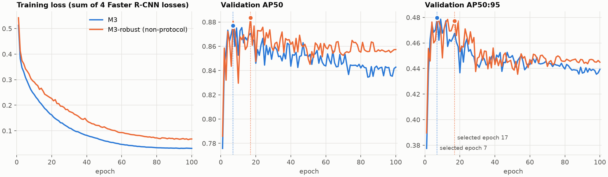
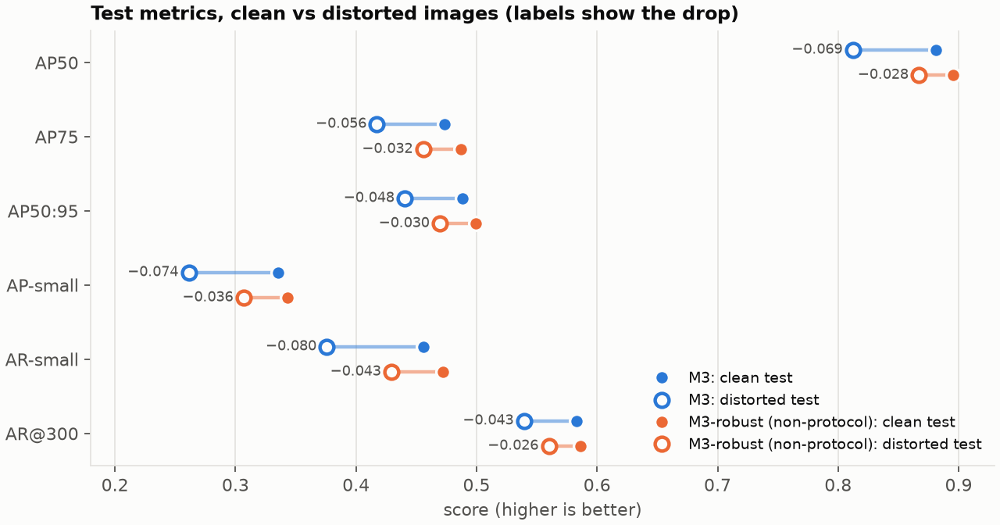
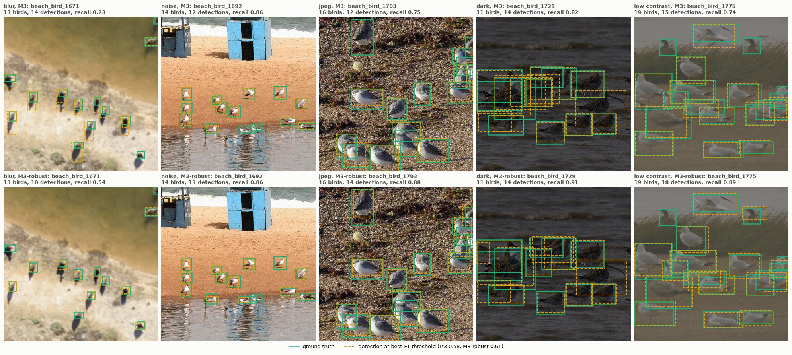
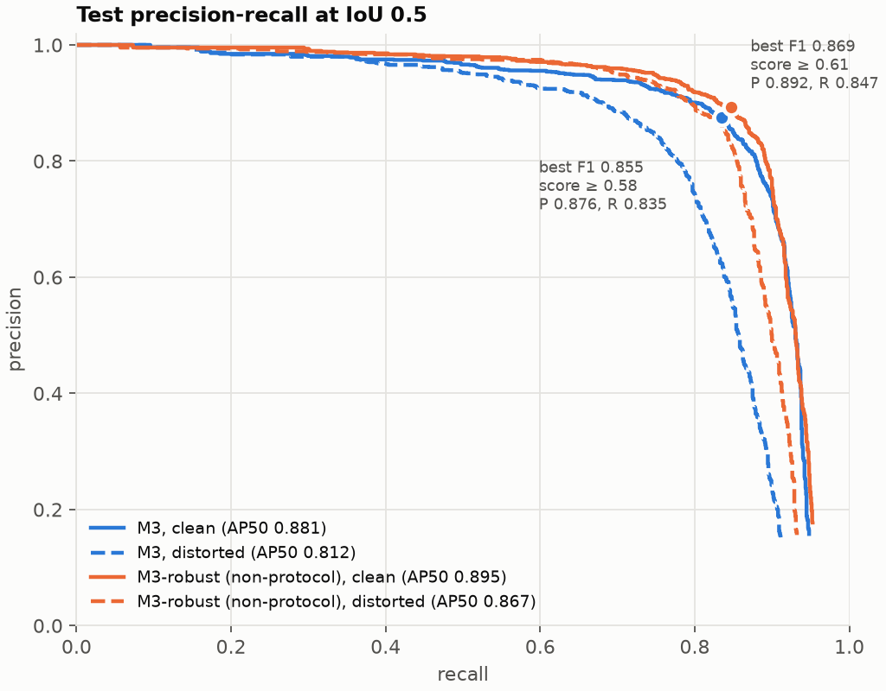
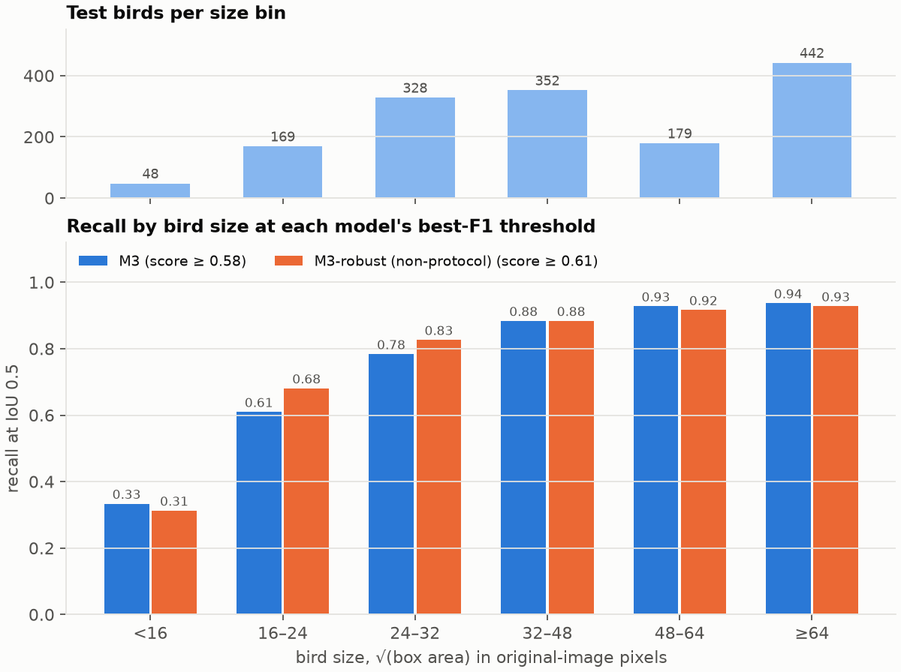
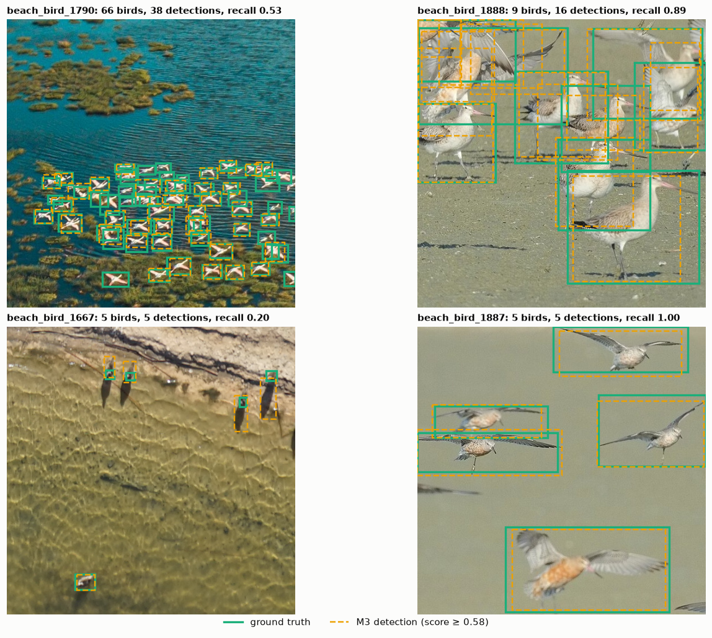

# M3: Faster R-CNN ResNet50-FPN V2

**Owner:** [your name] | **Group:** Group 104 | **Course:** COMP9517 2026 T3

## Summary of work completed

- **Data preparation:** Official Beach Bird Detection Dataset split (train 1,369 / val 291 / test 240 images), YOLO-format labels mapped to one foreground class (`bird` = 1, background = 0). Images are letterboxed to a 640x640 canvas (aspect-preserving, pad value 114), and Faster R-CNN's internal resize is disabled (`min_size = max_size = 640`).
- **Model:** Faster R-CNN ResNet50-FPN V2 from the official COCO weights (`fasterrcnn_resnet50_fpn_v2_coco-dd69338a.pth`), box predictor replaced with background + bird. `trainable_backbone_layers = 3`; backbone BatchNorm frozen (statistics and affine parameters).
- **Training:** 100 epochs, no early stopping. Batch 2, gradient accumulation 2 (effective batch 4, 343 optimiser updates per epoch), the final partial accumulation group flushed and normalised by its image count. SGD (momentum 0.9, Nesterov off, weight decay 0.0001), peak LR 0.0025 with a 1-epoch linear warm-up from 10% of peak, then cosine decay to 1% of peak, advanced per optimiser update. AMP FP16. Horizontal flip p = 0.5. Seed 42 for Python, NumPy, PyTorch, CUDA and data-loader workers.
- **Model selection:** validation on all 291 images every epoch. `best.pt` = highest val AP50, ties broken by AP50:95, then the earlier epoch. Best epoch: **7**. `last.pt` after every epoch, archive every 10 epochs.
- **Inference:** RPN NMS 0.7; RoI output score threshold 0.001, greedy hard NMS at IoU 0.6, at most 300 boxes per image, no second suppression. Boxes are written in original image pixels.
- **Predictions generated** for the validation and test sets from `best.pt`, after training finished. The test split was not used before then.

## Results

COCO-style evaluation, maxDets `[1, 10, 300]`, score prefilter 0.001.

| Split | AP50 | AP50:95 | AP75 | AP-small | AR-small | AR@300 |
|---|---|---|---|---|---|---|
| Val | 0.877 | 0.480 | 0.456 | 0.297 | 0.447 | 0.578 |
| **Test** | **0.881** | **0.488** | **0.473** | **0.335** | **0.456** | **0.583** |

Official metrics (precision, recall, F1, false positives per negative image, density groups) are computed by the shared group evaluator from the prediction files listed below.

Robustness check (not a protocol result): the same `best.pt` scored on fixed, seeded distorted copies of val and test (blur, noise, JPEG, dark, low contrast, cycled per image).

| Split | AP50 | AP50:95 | AP75 | AP-small | AR-small | AR@300 |
|---|---|---|---|---|---|---|
| Val (distorted) | 0.840 | 0.452 | 0.427 | 0.262 | 0.401 | 0.550 |
| Test (distorted) | 0.812 | 0.440 | 0.417 | 0.261 | 0.376 | 0.539 |

### M3-robust (non-protocol variant)

Identical to M3 except for extra training-time distortion augmentation (p 0.8 brightness/contrast/saturation x[0.6, 1.4]; p 0.25 each Gaussian blur r[0.5, 2], Gaussian noise sd[3, 15], JPEG quality [20, 70]). It is **not** a protocol configuration and is reported separately. Best epoch: **17**.

| Split | AP50 | AP50:95 | AP75 | AP-small | AR-small | AR@300 |
|---|---|---|---|---|---|---|
| Val | 0.883 | 0.477 | 0.449 | 0.302 | 0.472 | 0.582 |
| Test | 0.895 | 0.499 | 0.487 | 0.343 | 0.472 | 0.586 |
| Val (distorted) | 0.862 | 0.461 | 0.432 | 0.268 | 0.436 | 0.564 |
| Test (distorted) | 0.867 | 0.470 | 0.456 | 0.307 | 0.429 | 0.560 |

## Training time

Hardware: Google Colab, NVIDIA Tesla T4. Python 3.13.16, torch 2.14.1+cu130, torchvision 0.29.1+cu130.

| Stage | M3 | M3-robust (non-protocol) |
|---|---|---|
| Pure training (100 epochs) | 15,657.9 s (about 157 s per epoch) | 16,082.5 s (about 161 s per epoch) |
| Validation (100 x 291 images) | 1,781.3 s (about 18 s per epoch) | 1,811.7 s (about 18 s per epoch) |
| **Total run (training + validation)** | **17,469.6 s (4.85 h)** | **17,925.5 s (4.98 h)** |
| Peak allocated GPU memory | 1,896 MB | 1,894 MB |

## Runtime benchmark (protocol section 7)

Setup: Tesla T4, batch 8, AMP FP16, 20 warm-up batches, then 3 timed passes over the 240 test images (720 images), images preloaded in RAM. torch 2.14.1+cu130, torchvision 0.29.1+cu130.

| Metric | M3 | M3-robust (non-protocol) |
|---|---|---|
| Throughput | 17.47 images/s | 16.75 images/s |
| Amortised time per image | 57.25 ms | 59.69 ms |
| Mean batch time | 457.99 ms | 477.54 ms |
| P95 batch time (full batches only) | 500.55 ms | 528.22 ms |
| Peak allocated GPU memory | 1,565 MB | 1,565 MB |

The benchmark keeps 9,124 (M3) and 8,148 (M3-robust) detections per pass, 7 and 4 more than the rows in `preds_test.csv`: FP16 kernel differences between Colab sessions move a few boxes across the 0.001 score threshold.

## Figures

All figures are drawn from the files in `results/` and `results_robust/` and the dataset's ground-truth labels. Matching is greedy one-to-one at IoU 0.5 in original-image pixels; the AP50 values it gives match the COCO numbers above.

### Training curves



Training loss falls steadily for all 100 epochs (M3 0.513 to 0.031), but validation accuracy peaks early: M3 reaches its best val AP50 at epoch 7 (AP50:95 0.480), then drifts down to AP50 0.843 / AP50:95 0.439 by epoch 100. The model overfits the 1,369 training images after the first few epochs, so selecting the checkpoint on validation AP50 matters more than the epoch budget. M3-robust's augmentation keeps its training loss about twice as high and slows the decline (epoch 100: AP50 0.857 / AP50:95 0.445), which is consistent with it acting as a regulariser.

### Clean vs distorted test images



On the distorted test copies (blur, noise, JPEG, darkening, low contrast), M3 loses 0.069 AP50 and 0.048 AP50:95. Small birds suffer most: AP-small drops by 0.074 and AR-small by 0.080. M3-robust roughly halves every drop (AP50 -0.028, AP50:95 -0.030, AR-small -0.043) and is also slightly better on clean images.

### Results by distortion type

Each test image gets one fixed distortion, cycled by its sorted index (`CORRUPTIONS[idx % 5]` in `dataset.py`), so each type covers 48 images. AP50 is computed on that subset of images; recall is at IoU 0.5 and each model's best-F1 threshold (M3 0.58, M3-robust 0.61). "Clean" is the same 48 images undistorted, so each row compares like with like.

| Distortion | Images | Birds | M3 AP50 clean | M3 AP50 distorted | M3 recall clean | M3 recall distorted | M3-robust AP50 clean | M3-robust AP50 distorted | M3-robust recall clean | M3-robust recall distorted |
|---|---|---|---|---|---|---|---|---|---|---|
| Gaussian blur (r 1.5) | 48 | 346 | 0.899 | 0.786 | 0.838 | 0.685 | 0.908 | 0.849 | 0.844 | 0.763 |
| Gaussian noise (sd 12) | 48 | 256 | 0.865 | 0.801 | 0.805 | 0.715 | 0.886 | 0.861 | 0.836 | 0.809 |
| JPEG (quality 25) | 48 | 346 | 0.886 | 0.825 | 0.853 | 0.734 | 0.886 | 0.859 | 0.847 | 0.798 |
| Dark (brightness x0.45) | 48 | 216 | 0.900 | 0.895 | 0.889 | 0.838 | 0.931 | 0.933 | 0.917 | 0.921 |
| Low contrast (x0.45) | 48 | 354 | 0.873 | 0.793 | 0.802 | 0.658 | 0.884 | 0.864 | 0.808 | 0.754 |

Blur hurts M3 most (AP50 -0.113, recall -0.153), followed by low contrast (AP50 -0.080, recall -0.144). Both remove the edge detail that separates small birds from sand and water. Darkening barely matters (AP50 -0.005): the birds keep their contrast against the background and only the overall brightness drops. M3-robust's AP50 drops are smaller for every type (blur -0.059, noise -0.025, JPEG -0.027, low contrast -0.020), and on dark images it shows no loss. Its training augmentation includes blur, noise, JPEG and brightness/contrast changes, so all five test distortions are close to conditions it saw during training.

### Example detections on distorted images



One test image per distortion type (the median by bird count among images with 8 to 30 birds), shown as the model saw it. The top row is M3 and the bottom row is M3-robust, each at its best-F1 threshold.
- **Blur** (`beach_bird_1671`): aerial view with long shadows. M3 recall falls to 0.23: on the blurred image its boxes stretch over each bird and its shadow, so they miss IoU 0.5 against the tight body labels (the same effect as `beach_bird_1667` below). M3-robust keeps tighter boxes and reaches 0.54.
- **Noise** (`beach_bird_1692`): well-separated gulls on sand. Both models find 12 of 14 birds; the noise changes little here.
- **JPEG** (`beach_bird_1703`): a packed group of sanderlings. Compression artefacts blur the boundaries between neighbouring birds and M3 finds 12 of 16 (recall 0.75); M3-robust finds 14 (0.88).
- **Dark** (`beach_bird_1729`): overlapping curlews in water. M3 finds 9 of 11 birds and M3-robust 10; the remaining errors come from overlapping birds, not from the darkening.
- **Low contrast** (`beach_bird_1775`): gulls against grey water and grass. M3 misses birds whose outline fades into the background (recall 0.74); M3-robust finds 17 of 19 (0.89).

### Precision-recall



Precision stays at or above 0.9 up to 0.80 recall (M3) and 0.83 (M3-robust), then falls off sharply; the remaining birds are found only with very low-confidence boxes, and recall tops out at 0.95. The best F1 is 0.855 for M3 at score >= 0.58 (precision 0.876, recall 0.835) and 0.869 for M3-robust at score >= 0.61 (precision 0.892, recall 0.847). On distorted images M3 holds 0.9 precision only up to 0.68 recall (0.74 precision at 0.8 recall), while M3-robust keeps it up to 0.80 recall, close to its clean curve.

### Recall by bird size



At each model's best-F1 threshold, recall rises from 0.33 for birds under 16 px (square root of box area, original pixels) to 0.61 at 16-24 px and 0.88 or more above 32 px. Tiny birds are the main source of misses. They are a small share of the 1,518 test birds, but 16-32 px birds make up a third of them. M3-robust improves the 16-24 px and 24-32 px bins (+0.07, +0.05) but not the smallest.

### Example detections



M3 at its best-F1 threshold on four test images: the most crowded image, a median, the worst and a best case by per-image recall.
- `beach_bird_1790`: a dense flock of small birds on water. 38 detections for 66 birds; many of the smallest birds score below the threshold.
- `beach_bird_1888`: overlapping godwits. Recall is high, but overlapping birds also produce merged and duplicate boxes (16 detections for 9 birds), which cost precision.
- `beach_bird_1667`: aerial view with long shadows. Every bird is detected, but the predicted boxes also take in part of the shadow while the labels are tight around the body, so most fall below IoU 0.5 and recall is 0.20. This is an annotation-convention mismatch more than a detection failure.
- `beach_bird_1887`: well-separated birds in flight against a plain background. All 5 found with tight boxes.

## Files submitted

**Code**
- `train.py`: training, per-epoch validation, checkpointing, resume, final val/test export
- `model.py`: Faster R-CNN ResNet50-FPN V2 with the protocol settings and frozen backbone BatchNorm
- `dataset.py`: YOLO-label dataset, 640x640 letterbox, flip augmentation, distorted evaluation copies
- `evaluate.py`: prediction export in original-image pixels and COCO metrics (AP50, AP50:95, AP75, AP-small, AR@300)
- `benchmark.py`: protocol runtime benchmark (section 7) on the test set
- `requirements.txt`

**Results (`results/`)**
- `preds_val.csv`, `preds_test.csv`: predictions (`image_id,category_id,x,y,width,height,score`; `image_id` is the file name without extension, `category_id` is 0)
- `preds_val_distorted.csv`, `preds_test_distorted.csv`: the same on the distorted copies (robustness check only)
- `metrics.jsonl`: one line per epoch: losses, LR, optimiser updates, AMP loss scale, training/validation time, peak GPU memory, val AP50, AP50:95, AP75, AP-small, AR-small, AR@300
- `final_metrics.json`: best epoch, total run time and final metrics for every split
- `config.json`: full run configuration, model settings and library versions
- `preds_test_timing.json`: runtime benchmark (per-pass and aggregate timings, peak GPU memory, environment)

**Non-protocol variant (`results_robust/`)**: the same files for M3-robust.

**Figures (`figures/`)**: `training_curves.png`, `clean_vs_distorted.png`, `pr_curve_test.png`, `recall_by_size.png`, `examples_test.png`, `examples_distorted.jpg` (see Figures above).

Checkpoints (`best.pt`, `last.pt`, `epochNNN.pt`) are not included because of their size.

## Setup

```
pip install -r requirements.txt
```

`--data` is the dataset folder that directly contains `images/` and `labels/` (e.g. `Beach Bird Detection Dataset v1.0`). On Colab, `kagglehub.dataset_download('liugalhigh/beach-bird')` provides it.

## Pipeline

1. `python train.py --data <root> --out <run folder>`: trains for 100 epochs, validating every epoch, then exports `preds_{val,test}[_distorted].csv`, `final_metrics.json` and `DONE` from `best.pt`. On Colab, put `--out` on Google Drive.
2. Re-running the same command resumes from `last.pt` (model, optimiser, AMP scaler, schedule position, best score and history); a finished run (`DONE` present) is not retrained.
3. `python benchmark.py --data <root> --ckpt <run folder>/best.pt --out <run folder>/preds_test_timing.json`: protocol runtime benchmark on a T4. Test images are preloaded in RAM; batch 8, FP16 autocast, eval and inference mode; 20 warm-up batches, then 3 timed passes over the full test set with CUDA synchronised at every batch boundary. Timing covers letterbox preprocessing, host-to-device transfer, the forward pass (including RPN and RoI NMS), coordinate restoration and the device-to-host copy. Reports aggregate throughput, mean and P95 batch time (full batches only), amortised ms/image and peak allocated GPU memory.

`--epochs` and `--limit N` (first N images per split) exist for smoke tests only. `--robust` trains a separate **non-protocol** variant with colour jitter, blur, noise and JPEG augmentation; write it to a different `--out`.

## Third-party libraries

PyTorch, torchvision (Faster R-CNN ResNet50-FPN V2 and COCO weights), NumPy, Pillow, pycocotools (COCO evaluation).

## Implementation notes

- `results_robust/preds_test.csv` has no rows for `beach_bird_1885`, a test image with no birds on which M3-robust produced no detections at all.
- Validation AP50 peaked at epoch 7 and no later epoch beat it. Per the protocol, the selected checkpoint is used regardless.
- AR@300 and the AP-small/AR-small values are read from COCOeval's arrays with a 300-detection cap, because `COCOeval.summarize()` hard-codes 100.
- Checkpoints are written atomically from a background thread, so Drive I/O does not stall training.
- Nondeterminism: `cudnn.benchmark = True`, and CUDA RoIAlign/scatter backward passes are nondeterministic.
